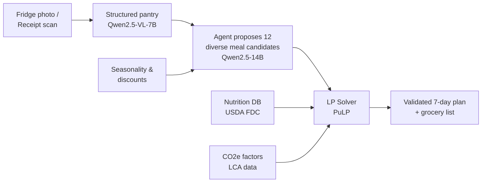

# 🥬 Zero-Waste Kitchen

**An open-source, locally-inferred AI meal planner for plant-based eating that minimizes cost, CO₂e, and food waste — while hitting your nutrition targets.**

Zero-Waste Kitchen builds a week of vegan meals around three inputs: **what's in your fridge**, **what's in season near you**, and **what's on sale at your local supermarket**. It then produces an optimized grocery list with cost, CO₂e, and nutrition per meal.

> People who try plant-based eating fail for two predictable reasons: nutrition anxiety ("where do I get protein?") and waste guilt (half the kale ends up in the bin). Both are *planning* problems — and planning is what this tool does.

## ✨ Features

- 📸 **Fridge &amp; receipt scanning** — snap a photo, get a structured pantry inventory with estimated shelf life
- 🥗 **Nutrition-validated plans** — protein, iron, B12, and micronutrient targets enforced by a solver, not guessed by an LLM
- 🌍 **CO₂e per meal** — life-cycle assessment factors for every ingredient
- 🗓️ **Seasonality-aware** — prioritizes produce in season in your region
- 🏷️ **Discount-aware** — imports weekly supermarket offers for your region
- 🧾 **Waste-optimized grocery list** — ingredients shared across meals, orphan ingredients penalized
- 🔒 **Private by architecture** — all model inference runs locally; your food photos never leave your machine

## 🧠 How it works

The core design principle: **the LLM proposes, the solver disposes.**



1. The vision model turns photos into a structured pantry inventory.
2. The planner model proposes diverse candidate meals — with strict, schema-validated structured output. It is **never** allowed to invent nutrition numbers.
3. A deterministic linear program (PuLP) selects the final plan, minimizing `cost + CO₂e + waste_penalty` subject to weekly nutrition constraints.
4. All nutrition and CO₂e facts come from open datasets (USDA FoodData Central, published LCA data) — no LLM in the ground-truth path.

This split is what makes it a product instead of a demo: the LLM supplies creativity and diversity; the solver guarantees the math is right.

## 🚀 Quick start

Prerequisites: Docker, Docker Compose, and an NVIDIA GPU with ≥ 8 GB VRAM (CPU works, just slower). Get a free [USDA FDC API key](https://fdc.nal.usda.gov/api-key-signup.html).

```bash
git clone https://github.com/juliansteinbock/zero-waste-kitchen.git
cd zero-waste-kitchen

export FDC_API_KEY=your_key_here

docker compose -f infra/docker-compose.yml up --build   # starts api, web, db, qdrant, ollama
bash infra/ollama-pull.sh                                # pulls quantized Qwen models
```

Then open [**http://localhost:5173**](http://localhost:5173). No signup required for one plan per week.

### Configuration


| Variable          | Purpose                                | Default                  |
| ----------------- | -------------------------------------- | ------------------------ |
| `FDC_API_KEY`     | USDA FoodData Central nutrition data   | required                 |
| `OLLAMA_BASE_URL` | Inference endpoint                     | `http://ollama:11434/v1` |
| `DATABASE_URL`    | Postgres connection                    | set by compose           |
| `ZWK_REGION`      | Region for seasonality &amp; discounts | `de-by` (Bavaria)        |


## 📦 Repository layout

```text
├── agent/     # schemas, tools, planner (LLM + LP solver)
├── models/    # nutrition (USDA), CO2e, seasonality, discounts
├── api/       # FastAPI service
├── web/       # SvelteKit frontend
└── infra/     # Docker Compose, Ollama model pull script
```

## 🤝 Contributing

Contributions welcome — especially new **regional seasonality tables**, **CO₂e factor improvements**, and **retailer discount adapters**. See [CONTRIBUTING.md](CONTRIBUTING.md) (good first issues are tagged `help wanted`).

```bash
# run tests
docker compose -f infra/docker-compose.yml run --rm api pytest -q
```

## 📄 License

MIT — see [LICENSE](LICENSE). Nutrition data: USDA FoodData Central (public domain). CO₂e factors derived from published life-cycle assessment literature; sources cited in `models/co2e.py`.

## 🙏 Acknowledgements

Built for the [Hacktoberfest Open-Source AI Challenge](https://dev.to/challenges/hacktoberfest-week2-2026-10-12). Powered by open-weight models (Qwen2.5) via [Ollama](https://ollama.com), [PydanticAI](https://ai.pydantic.dev), [Qdrant](https://qdrant.tech), and open data from [USDA FDC](https://fdc.nal.usda.gov).
